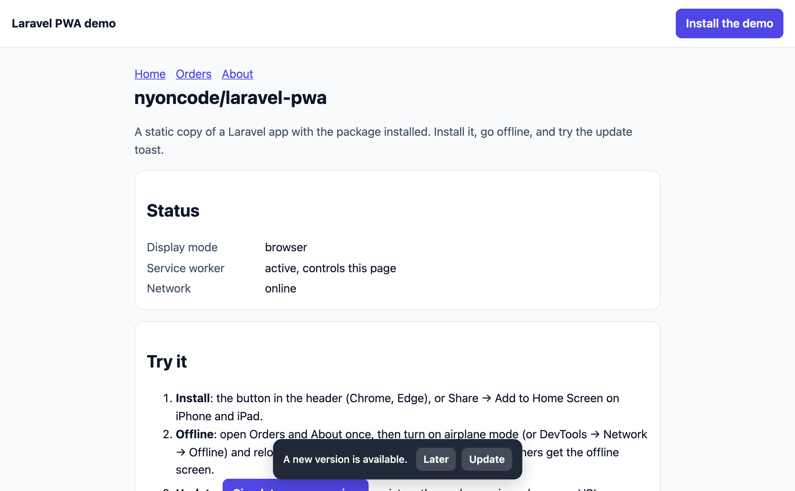
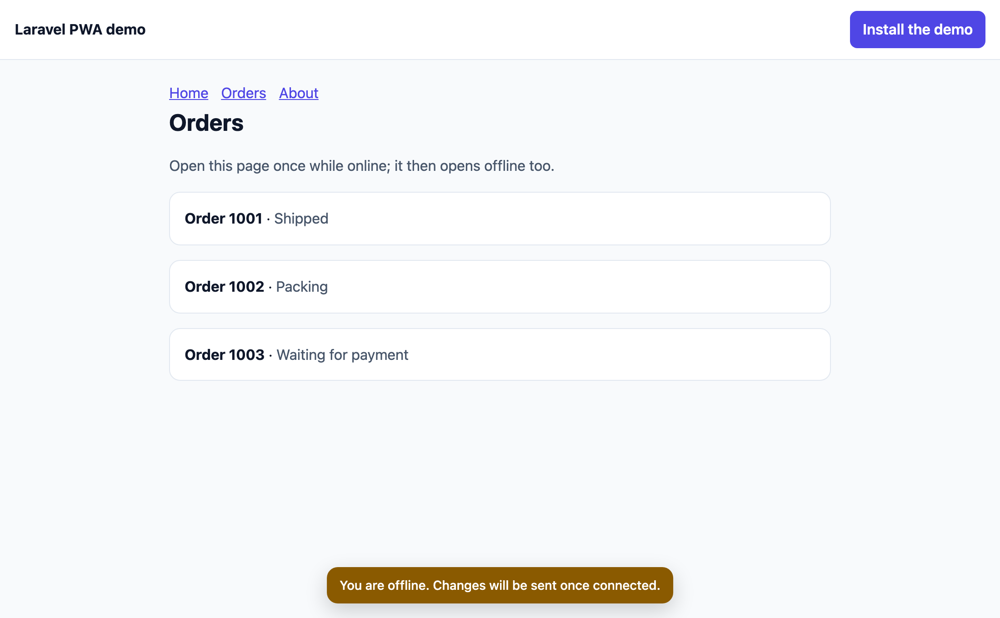
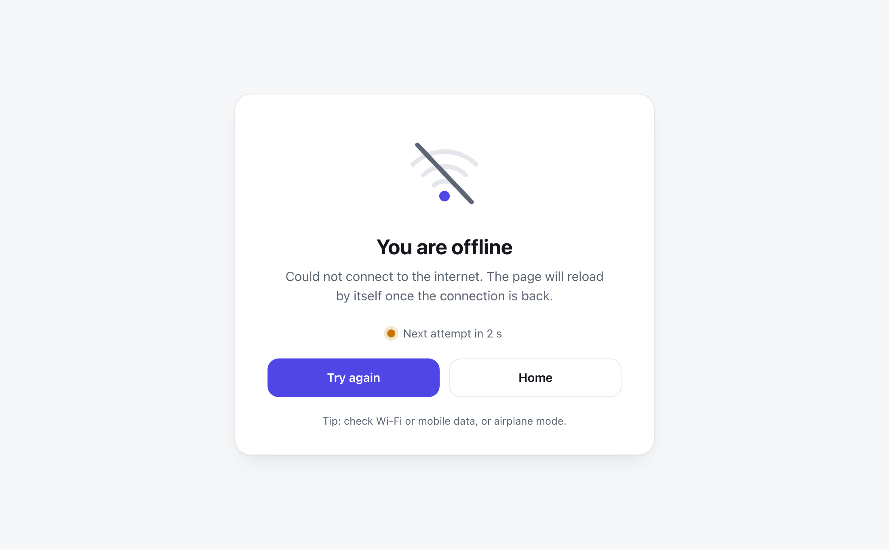
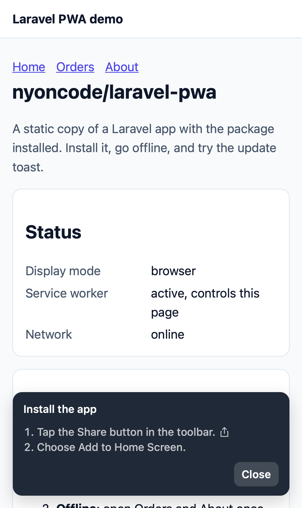

# Laravel PWA

[](https://packagist.org/packages/nyoncode/laravel-pwa)
[](https://github.com/NyonCode/laravel-pwa/actions/workflows/tests.yml)
[](https://github.com/NyonCode/laravel-pwa/actions/workflows/static.yml)
[](phpstan.neon.dist)
[](composer.json)
[](composer.json)
[](LICENSE.md)

**A production-grade Progressive Web App for Laravel.** Make your app installable, keep it working
offline without ever showing one user another user's data, keep installed apps signed in, show a
real maintenance screen, and switch the service worker off on every device with one command.

[Documentation](https://nyoncode.github.io/laravel-pwa/) · [Live demo](https://nyoncode.github.io/laravel-pwa/demo/) · [Čeština](README.cs.md) · [Changelog](CHANGELOG.md) · [Upgrade guide](UPGRADE.md)

| Update toast | Offline: cached page | Offline: never opened | iPhone install |
| --- | --- | --- | --- |
|  |  |  |  |

Screenshots from the [live demo](https://nyoncode.github.io/laravel-pwa/demo/), a static copy of an app with the package installed.

## Quick start

```bash
composer require nyoncode/laravel-pwa
php artisan pwa:install
php artisan pwa:icons resources/pwa/icon.png
```

```blade
<head>
    <meta name="viewport" content="width=device-width, initial-scale=1, viewport-fit=cover">
    <x-pwa::head/>
</head>
```

```bash
npm run build && php artisan pwa:build   # on every deploy (also runs with php artisan optimize)
php artisan pwa:doctor                   # checks HTTPS, icons, build, maintenance exceptions, session
```

That is a complete, installable PWA with an offline screen. Everything else is opt-in.

## Why this package?

Most PWA packages generate a manifest and a generic service worker. The hard part of a PWA in a
real Laravel app is everything around it, and that is what this package is built for:

- **The server decides what is cached.** No HTML page is stored until a route opts in with the
  `pwa.cache` middleware. Authenticated pages never leak into a generic "cache everything" rule.
- **Caches are per user.** Pages, API responses and images are stored per signed-in user and purged
  on logout or when another user signs in on the same device, including XHR logins (Inertia,
  Livewire, SPAs).
- **Maintenance is not "offline".** The worker tells a `503` from a network failure, shows your
  maintenance screen and keeps the cache intact. `php artisan pwa:down` wraps `artisan down`.
- **Installed apps stay signed in.** Remember-me in the installed app, a sliding session and an
  automatic CSRF refresh, so users never see a `419`.
- **A kill switch.** `php artisan pwa:disable` removes the service worker from every device without
  a deploy, because a broken worker survives a fixed server.
- **One app, one URL.** Desktop Edge and Chrome get `minimal-ui` with Back and Reload buttons;
  phones, tablets and Safari get `standalone`. No user-agent sniffing.
- **Push that respects shared devices.** Optional web push with a Laravel notification channel:
  logout removes the device's subscription, and a device where someone else is signed in shows a
  neutral notification instead of the content.

## Features

| Area | What you get | Docs |
| --- | --- | --- |
| Manifest | `/manifest.webmanifest` from config and a fluent API, display modes, icons, shortcuts | [Manifest](docs/en/manifest.md), [Display modes](docs/en/display-modes.md) |
| Icons and splash | `pwa:icons`: any, maskable, monochrome and iOS icons, iOS splash screens for every iPhone and iPad | [Commands](docs/en/commands.md#pwaicons) |
| Dynamic manifest | Per-request resolvers for tenants, branding and locales; Octane-safe | [Manifest](docs/en/manifest.md#resolvers-tenants-and-branding) |
| Service worker | Built from your Vite manifest, versioned, auto-updating | [Service worker](docs/en/service-worker.md) |
| Cache rules | network-first, cache-first, stale-while-revalidate, network-only, cache-only; per user or shared; limits and expiry | [Cache rules](docs/en/service-worker.md#cache-rules) |
| Offline | Offline screen, offline pages with server consent, warm-up of unvisited pages, offline queue for forms and API calls | [Offline](docs/en/offline.md) |
| Push notifications | Optional: `WebPushChannel`, `Pwa.push.subscribe()`, VAPID keys, per-device subscriptions, Declarative Web Push, `WebPush::fake()` | [Push notifications](docs/en/push.md) |
| Multi-tenant | One installable app per path tenant (`/t/acme/`): own worker scope, manifest identity and caches | [Multi-tenant apps](docs/en/tenancy.md) |
| Session | Persistent login in the installed app, keep-alive, CSRF refresh | [Persistent login](docs/en/session.md) |
| Maintenance | Maintenance screen, `pwa:down`, 503 vs. network failure | [Maintenance](docs/en/maintenance.md) |
| Kill switch | `pwa:disable` / `pwa:enable` | [Kill switch](docs/en/kill-switch.md) |
| Client | `window.Pwa`, `pwa:*` events, Livewire and Inertia adapters | [Client](docs/en/client.md), [Adapters](docs/en/adapters.md) |
| Events | `ManifestResolving`, `ServiceWorkerBuilt`, kill switch, telemetry and push events | [Events](docs/en/events.md) |
| Testing | `asInstalledApp()`, `assertPwaCacheable()`, `assertValidManifest()` and more | [Testing](docs/en/testing.md) |
| Extensibility | `sw.import` / `sw.extend` and `self.PwaWorker` for your own worker code | [Service worker](docs/en/service-worker.md#swextend) |
| AI agents | MCP server, agent guide and Claude Code skill, read from your installed version | [AI agents](docs/en/ai.md) |

## A taste of the API

```php
// Pages available offline (the server consents per route)
Route::get('/dashboard', DashboardController::class)->middleware('pwa.cache');

// Remember-me in the installed app
Route::post('/login', LoginController::class)->middleware('pwa.remember');

// Cache rules for API calls, in AppServiceProvider::boot()
Pwa::serviceWorker()->cache('/api/catalog*')->staleWhileRevalidate()->maxEntries(200)->maxAge(days: 1);

// A manifest per tenant
Pwa::manifest()->resolveUsing(fn (Request $request, ManifestBuilder $manifest) => $manifest
    ->name($request->tenant()->name)
    ->themeColor($request->tenant()->color));
```

```php
// In your tests
$this->asInstalledApp()->get('/dashboard')->assertPwaCacheable();
$this->get('/manifest.webmanifest')->assertValidManifest();
```

## Commands

| Command | What it does |
| --- | --- |
| `pwa:install` | Publishes the config and prints the next steps |
| `pwa:build` / `pwa:clear` | Builds / removes the service worker (hooked into `optimize`) |
| `pwa:icons {source}` | Generates any, maskable, apple-touch-icon and favicon icons |
| `pwa:down` | `artisan down` with the PWA maintenance screen |
| `pwa:disable` / `pwa:enable` | Kill switch for the service worker on every device |
| `pwa:push:vapid` | Generates the VAPID keys for web push |
| `pwa:push:prune` | Deletes expired and long-unused push subscriptions (schedule it daily) |
| `pwa:doctor` | Checks HTTPS, icons, build, cache rules, maintenance exceptions, session |

## Documentation

| Getting started | Features | Integrations | Operations |
| --- | --- | --- | --- |
| [Overview](docs/en/index.md) | [Display modes](docs/en/display-modes.md) | [JavaScript client](docs/en/client.md) | [Commands](docs/en/commands.md) |
| [Installation](docs/en/installation.md) | [Manifest](docs/en/manifest.md) | [Events](docs/en/events.md) | [Deployment](docs/en/deployment.md) |
| [Configuration](docs/en/configuration.md) | [Blade components](docs/en/components.md) | [Multi-tenant apps](docs/en/tenancy.md) | [Security](docs/en/security.md) |
| | [Service worker](docs/en/service-worker.md) | [Livewire and Inertia](docs/en/adapters.md) | [Platform support](docs/en/platforms.md) |
| | [Offline](docs/en/offline.md) | [Push notifications](docs/en/push.md) | [Troubleshooting](docs/en/troubleshooting.md) |
| | [Persistent login](docs/en/session.md) | [AI agents](docs/en/ai.md) | [Testing](docs/en/testing.md) |
| | [Maintenance](docs/en/maintenance.md) | | [Versioning](docs/en/versioning.md) |
| | [Kill switch](docs/en/kill-switch.md) | [Recipes: starter kits, Fortify, Filament](docs/en/recipes.md) | |

The documentation is also available in [Czech](docs/cs/index.md).

## Support policy

| Version | PHP | Laravel | Status |
| --- | --- | --- | --- |
| 1.x | 8.2 – 8.5 | 12, 13 | Active |

The package follows [Semantic Versioning](docs/en/versioning.md): minor releases never break the
public API. Laravel 11 and older are end of life and not supported. Every release is tested against
the lowest and the latest dependencies on every supported PHP and Laravel version.

## AI agents and MCP

The package ships documentation for coding agents inside `vendor/`, so an agent reads the version
from your `composer.lock`, not from its training data:

```bash
vendor/bin/pwa-ai install
```

This adds a block to `AGENTS.md`, the `laravel-pwa` Claude Code skill and the `laravel-pwa` MCP
server to `.mcp.json` (Node 18+, no dependencies). See [AI agents](docs/en/ai.md).

## Contributing and security

See [CONTRIBUTING.md](CONTRIBUTING.md). Please report vulnerabilities privately as described in
[SECURITY.md](SECURITY.md), not in public issues.

## License

MIT. See [LICENSE.md](LICENSE.md).
